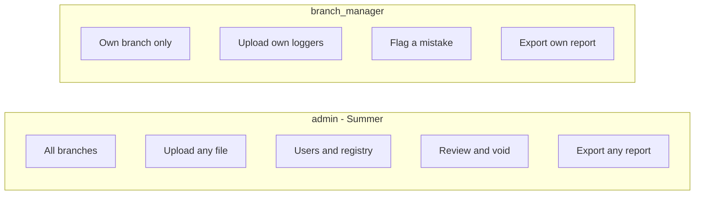
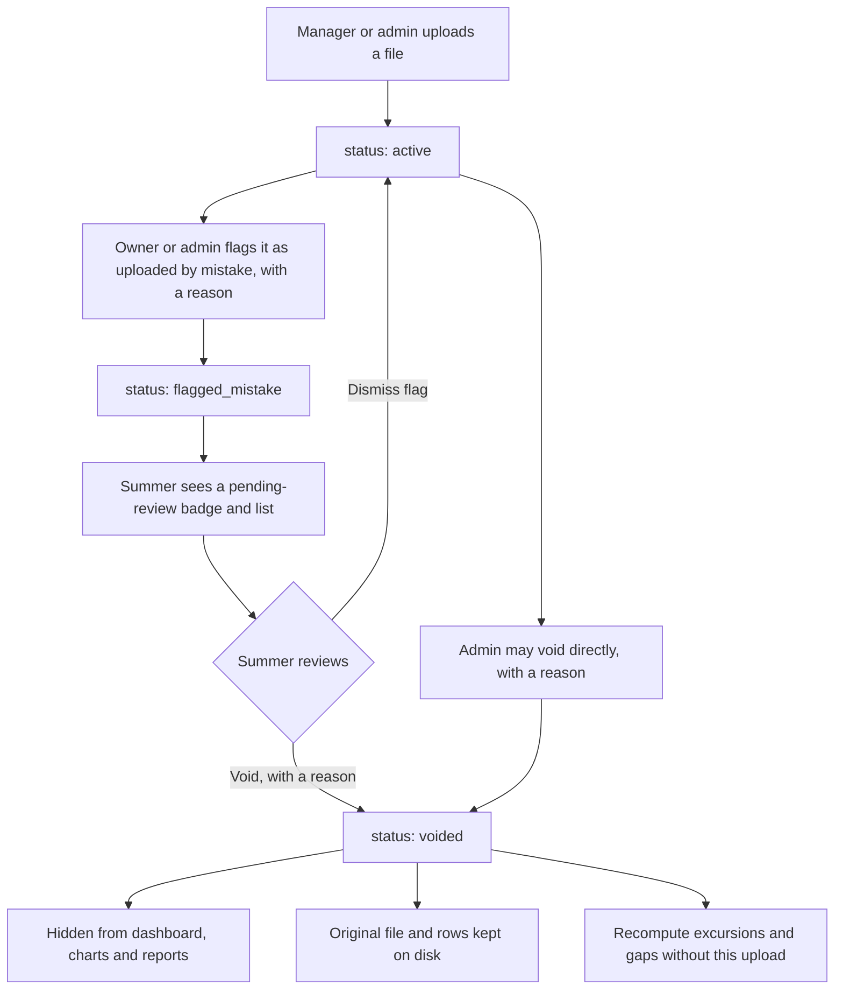

# Squanchy Kitchens: Authentication and Roles

> **Repository copy:** the demo password and secret defaults from the original spec are redacted here. The implementation ships no secrets: see the README, "Sign-in".

A self-contained feature spec for login, roles and audit in **Squanchy Kitchens**. The rest of the product (parser, rules, Compose, the three core screens) lives in `squanchy-kitchens-development.md`. Follow that file for stack, Docker-only review, and data rules. This file is only the auth layer.

The assignment constraint still holds: the app must run on a laptop from the README, with no accounts at third-party services and no paid APIs. That is why there is no email password-reset and no OAuth provider. Demo users are seeded locally.

---

## 1. Goals

- Summer (admin) and each branch manager sign in with a username and password. There is no public sign-up.
- A branch manager belongs to exactly one branch, sees only that branch, and can upload files and export that branch's inspector report for a Ministry visit.
- Managers no longer email files to Summer for her to paste. They upload directly. Summer still sees every branch, reviews mistakes, and is the only person who can void an upload or manage users and the logger registry.
- Enforcement is on the API, not only in the Angular UI. A crafted request must not read or change another branch.
- Uploads are never physically deleted. A void is a soft delete, the original file stays on disk, and excursions are recomputed without that file. The Ministry may still ask what was uploaded.
- A password reset does not go out by email (that would need Gmail or SMTP, which breaks the no-accounts / free-only rule). Summer resets a password from the Users screen. Self-service email reset is future work.

---

## 2. Roles and permission matrix

Two roles only.

**`admin`** (Summer Smith). Not tied to a branch (`users.branch_id` is null).

- Upload raw files for any branch.
- Soft-delete (void) any upload, and review files flagged "uploaded by mistake".
- Manage users: create branch managers, assign a branch, reset a password, deactivate.
- Manage the logger registry (add or end assignments).
- See every branch on the dashboard, fridge charts and inspector report, and export a report for one branch or all branches.
- Read the audit log.

**`branch_manager`**. Belongs to exactly one branch.

- Upload raw files only for loggers that were assigned to *their* branch on the dates inside the file. The API checks `logger_assignments` and rejects the upload otherwise.
- View only their own branch: dashboard, fridge charts, uploads, inspector report.
- Export their branch's inspector report (CSV; PDF optional) for a health-ministry inspection.
- Flag one of *their own* uploads as "uploaded by mistake", with a reason. That notifies Summer in-app (pending-review list and a badge on her dashboard).
- Cannot void or delete uploads, cannot manage users, cannot change the registry, cannot see other branches or the audit log.

| Action | admin | branch_manager |
|---|---|---|
| Log in, view `/api/auth/me`, change own password, log out | yes | yes |
| Upload a file for any branch | yes | no |
| Upload a file whose readings belong to their branch on those dates | yes | yes |
| Upload a file for a logger assigned to another branch | yes | no — `403` or `422` |
| List / view dashboard, fridge series, report | all branches | own branch only |
| Export inspector report (CSV, optional PDF) | any branch or all | own branch only |
| Flag own upload as "uploaded by mistake" | yes | yes (own uploads only) |
| Flag someone else's upload | yes | no — `403` |
| Review pending flags, dismiss a flag, void an upload | yes | no — `403` |
| Create / deactivate users, assign branch, reset password | yes | no — `403` |
| Manage logger registry (write) | yes | no — `403` |
| List loggers (read) | all | own branch only, read-only |
| Read audit log | yes | no — `403` |



---

## 3. JWT flow

Libraries (added to `backend/pyproject.toml`, still installed only inside the API image):

- `pyjwt` — sign and verify access tokens.
- `passlib[bcrypt]`, or the `bcrypt` package directly. Either is fine. `passlib` matches the usual FastAPI OAuth2 password examples; `bcrypt` is enough if you want one fewer dependency. Hash every stored password. Never store or log the plaintext.

FastAPI uses the OAuth2 password flow (form-encoded `username` and `password` at login, so OpenAPI's "Authorize" works).

| Method | Path | Who | Description |
|---|---|---|---|
| POST | `/api/auth/login` | public | OAuth2 password: `username`, `password`. Returns `{ access_token, token_type: "bearer", must_change_password }`. `401` on bad credentials or a deactivated user. |
| GET | `/api/auth/me` | any signed-in user | Current user: id, username, full_name, role, branch_id, branch name, must_change_password. Loaded from the database, not only from the token. |
| POST | `/api/auth/change-password` | any signed-in user | Body: `current_password`, `new_password`. Clears `must_change_password`. |
| — | logout | client-side | Tokens are stateless. Logout drops the token in the browser. No server denylist in this version. |

There is **no** `POST /api/auth/register` and **no** "forgot password" email.

**Token claims:** `sub` (user id), `username`, `role` (`admin` \| `branch_manager`), `branch_id` (null for admin), `exp`. Treat `role` and `branch_id` in the token as a hint only. Every request loads the user from the database and uses the live `role`, `branch_id` and `is_active`. A deactivated user, or one whose branch was changed, is denied even if an old token is still unexpired.

**Expiry:** `JWT_EXPIRE_MINUTES`, default `480` (8 hours). Summer is between branches most of the day; a one-hour token would be annoying on a phone. No refresh-token rotation in this version.

**After an admin reset (or a newly created manager):** `must_change_password` is true. Login still succeeds, but the Angular app routes to a change-password screen and the API may reject other endpoints with `403` and a `must_change_password` code until the password is changed.

---

## 4. Seeded users and environment

Compose defaults, same `${VAR:-default}` style as the rest of the stack. A `.env` file is not required. These go on the `api` service alongside the existing variables (and should be listed in the development guide's env sketch).

```yaml
ADMIN_USERNAME: ${ADMIN_USERNAME:-admin}
ADMIN_PASSWORD: ${ADMIN_PASSWORD:-}
ADMIN_FULL_NAME: ${ADMIN_FULL_NAME:-Summer Smith}
JWT_SECRET: ${JWT_SECRET:-}
JWT_EXPIRE_MINUTES: ${JWT_EXPIRE_MINUTES:-480}
DEMO_MANAGER_PASSWORD: ${DEMO_MANAGER_PASSWORD:-}
```

On first start, after migrations:

1. If no user with username `admin` exists, create the admin (role `admin`, `branch_id` null, password from `ADMIN_PASSWORD`). If the admin already exists, do not overwrite the password on later boot (otherwise a changed password would be reset every time the container restarts).
2. If `SEED_DEMO_DATA=true`, also create one `branch_manager` per branch, when that username is not already present. Demo seed uploads are recorded as `uploaded_by` the admin.

The README (and the login page in demo mode, if you want) must print the demo credentials so a reviewer can sign in after `docker compose up --build`.

**Seeded admin**

| Username | Password | Role | Branch |
|---|---|---|---|
| `admin` | *(provided separately)* | admin | — (all branches) |

**Optional demo managers** (`SEED_DEMO_DATA=true`). Shared demo password: *(provided separately)*.

| Username | Branch |
|---|---|
| `manager.haifa` | Haifa |
| `manager.rishon` | Rishon LeZion |
| `manager.telaviv` | Tel Aviv |
| `manager.jerusalem` | Jerusalem |
| `manager.beersheva` | Be'er Sheva |
| `manager.netanya` | Netanya |
| `manager.petah` | Petah Tikva |
| `manager.ashdod` | Ashdod |
| `manager.herzliya` | Herzliya |
| `manager.beitshemesh` | Beit Shemesh |
| `manager.kfarsaba` | Kfar Saba |
| `manager.rehovot` | Rehovot |

A password and a `JWT_SECRET` committed as Compose defaults in a **public** repository are demo-only, for reviewers on a laptop. Say so in `NOTES.md`. A real deployment must set `ADMIN_PASSWORD` and `JWT_SECRET` via environment (or a secret) and change the admin password before anyone uses real Ministry data.

---

## 5. Data model additions

Existing tables stay as in the development guide, with the `uploads` columns below added.

**`users`**

- `id`
- `username` unique
- `full_name`
- `password_hash`
- `role` enum: `admin` \| `branch_manager`
- `branch_id` nullable FK to `branches`. Null for admin. Required for `branch_manager`.
- `is_active` (default true)
- `must_change_password` (default false; set true on create and on admin reset)
- `created_at`

**`uploads`** — add to the existing table:

- `uploaded_by` FK to `users`
- `status` enum: `active` \| `flagged_mistake` \| `voided` (default `active`). This replaces a free-text or single-purpose `status` if one was already planned for import progress; keep import progress separately if you need it (e.g. `import_state`: `complete` \| `failed`) so it is not mixed with the review lifecycle.
- `flagged_by` nullable FK, `flag_reason` text, `flagged_at`
- `voided_by` nullable FK, `voided_at`, `void_reason`

A `flagged_mistake` upload is still included in dashboards, charts, excursion recomputes and reports. It is only a request for Summer to look. A `voided` upload is hidden from those views, excluded from excursion and gap recompute, and excluded from reports, but the row, the readings and the original file are **never physically deleted**. After a void, recompute excursions and gaps for the affected logger(s) from remaining `active` / `flagged_mistake` readings only.

`sha256` uniqueness: it must not block a legitimate re-upload of a file that was voided. Use a unique constraint on `sha256` among non-voided rows (a MySQL 8 filtered/composite approach, or an application check plus a unique key you can live with). The "identical hash already imported" short-circuit applies only to non-voided uploads.

**`audit_log`**

- `id`
- `user_id` FK (the actor; nullable only if you ever record system seeds)
- `action` (e.g. `upload.created`, `upload.flagged`, `upload.flag_dismissed`, `upload.voided`, `user.created`, `user.deactivated`, `user.password_reset`, `user.branch_changed`, `report.exported`, `registry.assignment_created`)
- `entity_type`, `entity_id`
- `details` JSON (branch, logger, filename, reason, target username — no passwords)
- `created_at`

Index `audit_log(created_at)`, `audit_log(user_id, created_at)`, `uploads(status)`, `users(username)`.

---

## 6. Flag → review → void



- A manager can flag only an upload they themselves made, and only while it is `active` or already `flagged_mistake` (updating the reason is allowed). They cannot flag another person's upload.
- Flagging does not take the data off the dashboard. Voiding does.
- Only an admin can dismiss a flag or void. Void needs a reason, written to `void_reason` and to the audit log.
- There is no manager-facing "delete".

---

## 7. API endpoints and backend enforcement

`GET /api/health` and `POST /api/auth/login` are public. Everything else requires a valid Bearer token for an active user. OpenAPI at `/api/docs` may stay publicly readable so reviewers can explore the contract; trying a write from there still needs "Authorize".

### Auth and users

| Method | Path | Who | Description |
|---|---|---|---|
| POST | `/api/auth/login` | public | See §3 |
| GET | `/api/auth/me` | signed-in | See §3 |
| POST | `/api/auth/change-password` | signed-in | See §3 |
| GET | `/api/users` | admin | List users |
| POST | `/api/users` | admin | Create a branch manager (username, full_name, branch_id, initial password). Sets `must_change_password`. |
| PATCH | `/api/users/{id}` | admin | Update name, branch, `is_active` |
| POST | `/api/users/{id}/reset-password` | admin | Set a temporary password, set `must_change_password=true`. The new password is returned once in the response (it is not emailed). |

### Uploads, review, audit

| Method | Path | Who | Description |
|---|---|---|---|
| POST | `/api/uploads` | admin: any logger; manager: own-branch loggers only | Same multipart as the development guide, plus server-side assignment check |
| GET | `/api/uploads` | scoped by role | History. Managers only see their branch |
| POST | `/api/uploads/{id}/flag` | owner manager, or admin | Body: `reason`. Sets `flagged_mistake` |
| POST | `/api/uploads/{id}/dismiss-flag` | admin | Back to `active` |
| POST | `/api/uploads/{id}/void` | admin | Body: `reason`. Soft-delete, then recompute |
| GET | `/api/uploads/pending-review` | admin | `flagged_mistake` list for the badge and review screen |
| GET | `/api/audit-log` | admin | Filter by action, user, date |

Existing dashboard, series, report, registry and branch endpoints keep their shapes from the development guide, with these rules:

- Managers are scoped to their `branch_id`. A `?branch=` query that is not their branch is `403`, not an empty 200.
- `POST /api/loggers/{code}/assignments` is admin only. `GET /api/loggers` is filtered for managers (read-only).
- `GET /api/report` and `GET /api/report.csv` (and optional PDF): a manager may export **their branch only**. An admin may export one branch or all. Every export is written to `audit_log`.
- Dashboard DTOs include **last upload** per branch (timestamp, filename, who). If the selected week has no active (non-voided) upload for a branch, that branch is marked missing and shown amber, even when there are no fridge-level gaps or errors yet.

### Enforcement

Do not rely on hiding buttons in Angular.

1. A FastAPI dependency loads the user by `sub` from the database (active check, live role and branch).
2. A second dependency, used by every branch-scoped query, forces `branch_id = current_user.branch_id` for managers and leaves admins unscoped.
3. Upload authorization is a server-side check: every timestamp in the file is resolved through `logger_assignments`. If a manager's file contains any reading whose assignment is not their branch, reject the whole upload with a clear message. Do not import a partial file.
4. Flag / void / user / registry / audit endpoints check role (and ownership, for flags) and return `403` on failure.
5. `branch_id` in the JWT is not trusted on its own.

---

## 8. Angular screens, interceptor and guards

Keep the three core screens (dashboard, fridge detail, inspector report). Add:

- **Login.** Username and password. On success, store the access token (localStorage is acceptable for this demo; the token already expires). If `must_change_password`, go to a change-password form before the dashboard.
- **Users** (admin only). Create a manager, assign a branch, reset password (show the temporary password once), deactivate.
- **Uploads list.** Filterable history. A manager can flag their own row, with a reason. An admin also sees void and dismiss actions.
- **Pending review** (admin only). The flagged list. Also a badge on the admin dashboard / toolbar with the pending count.

HTTP interceptor: attach `Authorization: Bearer <token>` to `/api/*` except login. On `401`, clear the token and route to login.

Route guards: an `authGuard` on every screen except login; an `adminGuard` on Users, Pending review, Registry write, Audit if you add a view. The interceptor and guards are not a substitute for the API checks in §7.

Logout clears the token and returns to login.

For a manager, the logger dropdown on upload lists only loggers assigned to their branch. The dashboard has no all-branches switch. "Last upload" is visible on the branch header; a missing week is amber, as above.

---

## 9. Tests

Add API tests (same container path: `docker compose run --rm api pytest`) on top of the parser and golden tests in the development guide. Use the seeded admin and at least two demo managers (for example `manager.rishon` and `manager.telaviv`).

Minimum cases:

- Login succeeds for admin and for a manager; fails for a bad password and for a deactivated user.
- Manager `GET /api/dashboard` (and series, report) for another branch returns `403`.
- Manager `GET /api/dashboard` for their own branch returns `200` and only that branch's fridges.
- Manager `POST /api/uploads` with a logger assigned to another branch on the file's dates returns `403` or `422` and writes no readings.
- Manager can upload a logger that belongs to their branch, and can `GET /api/report.csv` for their branch (`200`).
- Manager `POST /api/uploads/{id}/void` returns `403`. Admin void returns `200`, hides the data, and excursions are recomputed.
- Manager cannot call `POST /api/users` or `GET /api/audit-log` (`403`).
- Flag by the owner notifies pending review; a manager cannot flag another user's upload.
- After void, a later import of the same file is allowed (the hash short-circuit ignores voided rows).

Frontend: a couple of guard / role tests (admin sees Users; a manager does not) are enough if time is short.

---

## 10. Build steps (about 3–4 hours)

Do this after the parser, golden test and the three core screens are standing, or at least after a working upload API. If the 48-hour window is tight, the development guide still wins: a solid unauthenticated slice is better than half-finished auth. This block is the auth slice.

1. [ ] **Model, migration, seed (45–60 min).** `users`, `uploads` review columns, `audit_log`. Seed admin on boot. Seed demo managers when `SEED_DEMO_DATA=true`. Compose env defaults for `ADMIN_PASSWORD`, `JWT_SECRET`, `JWT_EXPIRE_MINUTES`.
2. [ ] **JWT and password endpoints (45 min).** Hashing, `/api/auth/login`, `/me`, `/change-password`, the current-user dependency.
3. [ ] **Scope every existing query (45–60 min).** Branch dependency, upload assignment check, `403` on cross-branch access. Wire `uploaded_by` on new uploads.
4. [ ] **Flag, void, pending review, audit writes (30–45 min).** Recompute after void. Hash short-circuit ignores voided files.
5. [ ] **Angular: login, interceptor, guards, Users, Uploads, Pending review, badge (45–60 min).** Last-upload and missing-week amber on the dashboard. Hide admin-only navigation from managers.
6. [ ] **Tests and README credentials (20–30 min).** The cases in §9. README prints demo admin and manager logins, and states they are demo-only.

Stretch if time remains: an admin audit-log screen, optional PDF export already listed in the development guide, `must_change_password` blocking other API routes.

---

## 11. NOTES.md additions

Add these bullets under "Decisions Summer didn't ask for, and why" (and under "What's not done" / future work as appropriate):

- Two roles, `admin` and `branch_manager`, with branch managers uploading directly instead of emailing Summer. She asked to "upload the files and see, in one place, how every fridge is doing." Giving each manager a login for their own branch, and keeping her as the person who sees everything, matches how the twelve branches already send her files — without building inbox automation.
- A manager can export their own branch's inspector report so they can hand it to a Ministry inspector without waiting for Summer.
- A manager can flag their own upload as "uploaded by mistake"; only Summer can void it. Void is a soft delete: the file and rows are kept, excursions are recomputed, and the audit log records who did it and why. Physical delete would be a poor fit for a health-ministry history.
- Passwords and `JWT_SECRET` defaults in this public repo are demo-only, so a reviewer can log in after `docker compose up`. A real deploy must set `ADMIN_PASSWORD` and `JWT_SECRET` in the environment and change the admin password.
- No self-service email password reset in this version. It would need Gmail or SMTP, which conflicts with "no accounts and no paid services." Summer resets a password from the Users screen. Email reset is listed as future work.

Also add under questions for Summer, if you want:

- Who should be allowed to void a file — only you, or also the manager who uploaded it, after a cooling-off period?
- Should a flagged file already be hidden from the inspector report, or only after you void it?

---

## 12. Future work

- Self-service "forgot password" by email, if the bakery later provides an SMTP account or a similar service.
- Refresh tokens, a token denylist on logout, or shorter-lived access tokens.
- More than two roles (for example a read-only inspector login).
- Email or push notifications when a fridge is mid-excursion, or when a flag is waiting for Summer. The in-app badge is the v1 notification.
- Automatic ingestion of files from Summer's inbox — still out of scope, and less necessary once managers upload themselves.
